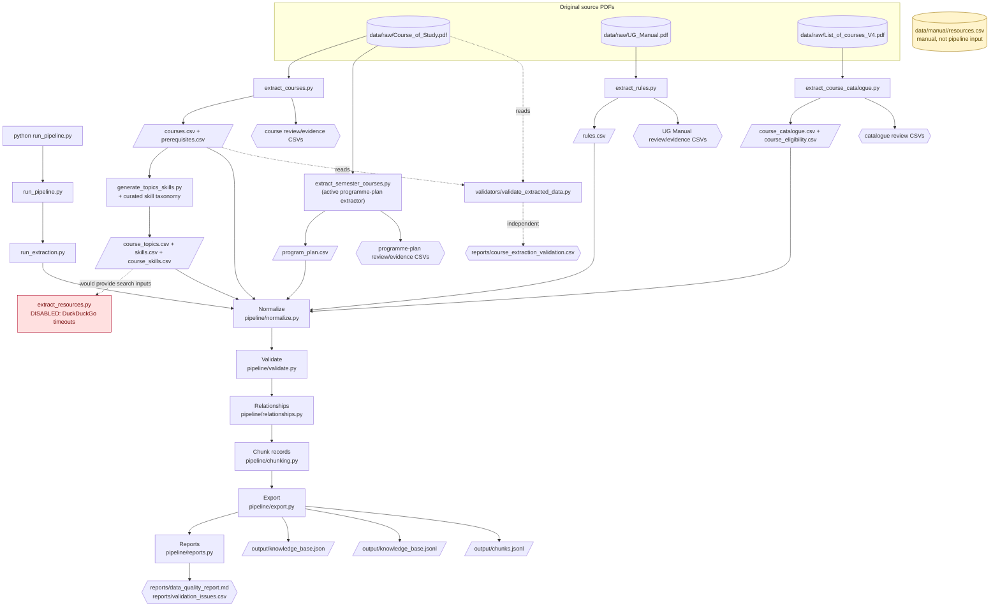

# Adobe DSAI Knowledge Base

Source-traced academic data pipeline for the B.Tech Data Science and Artificial Intelligence (DSAI) programme at IIT Bhilai.

## Overview

- Reads three public institute PDFs from `data/raw/`.
- Extracts course, rule, programme-plan, catalogue, eligibility, topic, and skill candidates.
- Preserves evidence and review files for manual inspection.
- Normalizes, validates, relates, chunks, and exports structured knowledge-base data.
- Stops before embeddings; the normal pipeline does not call an LLM or embedding API.
- Keeps manually collected resources separate from automatic extraction.

## Problem statement

Academic information is distributed across PDF documents and contains incomplete, duplicated, or ambiguous records. This project turns that information into structured candidates that can be reviewed, connected, and consumed by a future retrieval system without claiming that every extracted record is verified.

## Project objectives

- Build a source-traced DSAI academic dataset.
- Preserve course prerequisites, skills, topics, programme structure, and eligibility relationships.
- Produce reviewable records rather than silently inventing missing values.
- Generate clean JSON/JSONL and chunk outputs for possible future retrieval.

## Data sources

| Source | Main information | Active extractor |
|---|---|---|
| `data/raw/Course_of_Study.pdf` | Course details, syllabus, prerequisites, programme-plan candidates | `extract_courses.py`, `extract_semester_courses.py` |
| `data/raw/UG_Manual.pdf` | Academic-rule candidates and evidence | `extract_rules.py` |
| `data/raw/List_of_courses_V4.pdf` | Catalogue and eligibility candidates | `extract_course_catalogue.py` |
| `data/manual/resources.csv` | Manually collected resource candidates | Not consumed by `run_pipeline.py` |

See [SOURCES.md](SOURCES.md) for provenance, outputs, and limitations.

## Architecture



## Quick Start

The virtual environment isolates project dependencies. `requirements.txt` installs the required packages.

```bash
git clone https://github.com/Jaswanth-Kumar-2007/Adobe_MP5_Task.git
cd Adobe_MP5_Task

python3 -m venv .venv
source .venv/bin/activate

python -m pip install --upgrade pip
pip install -r requirements.txt

python run_pipeline.py
```

Before running, ensure the original PDFs are present in `data/raw/`. The command performs source extraction, normalization, validation, relationship generation, chunking, export, and reporting.

Expected locations:

- `data/extracted/` — extraction-stage CSVs and review/evidence files.
- `data/processed/` — normalized data and generated relationships.
- `data/processed/relationships/` — `course_relationships.json`.
- `output/` — final knowledge-base JSON, JSONL, and chunks.
- `reports/` — logs, validation issues, and data-quality report.

## Project documentation

- [Extraction Documentation](docs/extraction.md)
- [Pipeline Documentation](docs/pipeline.md)
- [Project Structure](docs/project-structure.md)
- [Sources](SOURCES.md)
- [Ideas](IDEAS.md)

## Extraction and pipeline workflow

1. `run_extraction.py` reads raw PDFs and writes extracted CSVs plus review/evidence files.
2. `pipeline/normalize.py` writes normalized entities to `data/processed/normalized/`.
3. `pipeline/validate.py` records structural errors and warnings.
4. `pipeline/relationships.py` writes course relationship JSON.
5. `pipeline/chunking.py` creates record-based chunks.
6. `pipeline/export.py` writes JSON and JSONL outputs.
7. `pipeline/reports.py` writes the data-quality report and validation issue CSV.

## Current implementation and audit results

Latest checked-in pipeline report metrics:

| Requirement | Status | Evidence |
|---|---|---|
| At least 15 courses | **PASS** | 25 normalized courses in `reports/data_quality_report.md`. |
| Course metadata completeness | **PARTIAL** | Required columns exist, but normalized syllabus is present for 24/25 courses, objectives are empty, and semester/type/mode fields are incomplete. |
| Academic rules | **PARTIAL** | 134 rule candidates; review files identify records needing human inspection. |
| At least 30 open learning resources | **PARTIAL** | 192 manual rows exist, but automatic discovery is disabled and licence verification and topic mappings are incomplete. |
| Normalization | **PASS** | `pipeline/normalize.py` normalizes fields and removes only unambiguous lower-quality duplicate course records. |
| Validation | **PARTIAL** | Structural, duplicate, credit, reference, provenance, and prerequisite checks exist; prerequisite-cycle detection remains incomplete. |
| Relationships | **PASS** | Course relationships are written to `data/processed/relationships/course_relationships.json`. |
| Chunking | **PARTIAL** | 669 record-based chunks are generated; the implementation does not split text into token or semantic windows. |
| Export | **PASS** | JSON, JSONL, and chunk JSONL outputs are generated under `output/`. |
| No embeddings/LLM API calls | **PASS** | The normal Python pipeline stops before embedding. |
| Data-quality report | **PARTIAL** | Counts, field-completeness percentages, nested review/evidence files, and six warnings are reported; semantic verification remains manual. |
| `SOURCES.md` | **PASS** | Source and extraction-output documentation is present. |
| `IDEAS.md` | **PASS** | Future Knowledge Buddy use cases and boundaries are documented. |

Latest report metrics are 25 normalized courses, 134 rules, 46 programme-plan records, 251 eligibility records, 185 topics, 125 course-skill mappings, 289 evidence records, 669 chunks, 0 validation errors, and 6 validation warnings. These are extracted or candidate records, not proof of semantic verification.

## AI usage disclosure

ChatGPT was used during development to help create and refine the Python extraction scripts and pipeline implementation. ChatGPT was also used for debugging assistance, code review, and documentation. The actual extraction and processing pipeline runs through the repository's Python scripts, handles PDFs and generated outputs locally, and does not call an LLM or embedding API during normal execution.

## Limitations and future improvements

- Automatic resource discovery is disabled because repeated DuckDuckGo requests timed out.
- `data/manual/resources.csv` is not consumed by `run_pipeline.py`.
- Academic rules, eligibility candidates, programme-plan records, and some course records require human review.
- Some course syllabus/objective fields are incomplete.
- PDF filenames are sometimes stored in `source_url` fields instead of clickable source URLs.
- Resource licences, direct URLs, topic mappings, and duration metadata are incomplete.
- The latest six warnings concern prerequisite references outside the collected course set.
- Future work should verify manual resources, licences, mappings, source URLs, and assignment deliverables without treating a zero-error run as full verification.
